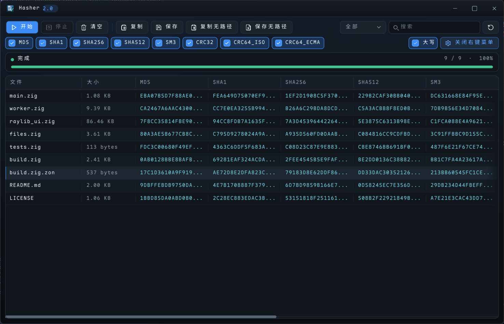

# Hasher

支持多种哈希算法、多线程计算的哈希工具，在文件数量比较多的时候，效率会比 MyHash 这类工具好一些。

单独计算大文件的多个哈希算法时，效率会不如 MyHash；不过本工具支持 SM3、CRC64 算法，弥补一下其他哈希工具的不足。



## 构建

需要 Zig 0.17.x（raylib-zig 依赖为 6.x）。

```powershell
zig build              # 构建到 zig-out/bin/hasher.exe
zig build test         # 运行单元测试
zig build run          # 构建并运行
```

Windows 上首次构建需要联网拉取 raylib-zig 及其传递依赖；若本机设置了 `HTTP_PROXY` / `HTTPS_PROXY`
而代理不可用，先清空这两个环境变量再构建。

## 使用

- 把文件或文件夹拖入窗口，选择算法后点「开始」；文件夹会递归收集其中的文件。
- 单击单元格选中，双击单元格复制该单元格内容。
- 表头可拖动调整列宽，也可拖动列改变顺序。
- 「复制 / 保存」包含完整路径，「复制无路径 / 保存无路径」只导出文件名与哈希，输出为带 BOM 的 CSV。
- 「全部」下拉框可限定搜索范围（文件名、大小、指定算法、完整路径）。
- 「开启右键菜单」会把 Hasher 注册到资源管理器的右键菜单，可对选中项直接计算哈希。

### 快捷键

| 快捷键 | 作用 |
| --- | --- |
| `Enter` | 开始计算 |
| `Ctrl + F` | 聚焦搜索框 |
| `Ctrl + V` | 在搜索框中粘贴 |
| `Ctrl + C` | 复制结果（含路径） |
| `Ctrl + S` | 导出 CSV（含路径） |
| `PageUp` / `PageDown` | 翻页滚动结果表 |
| `Home` / `End` | 跳到首行 / 末行 |
| `Esc` | 关闭下拉框、退出搜索 |

## 界面与动效

- 行进入、完成有入场与脉冲提示，计算过程中进度条带流光扫描。
- 表格滚动、悬停、按钮、复选框、下拉框、Toast 均为插值动画，滚动带阻尼。
- 界面按显示器 DPI 栅格化字体，支持 125% / 150% 缩放下的清晰文本。
